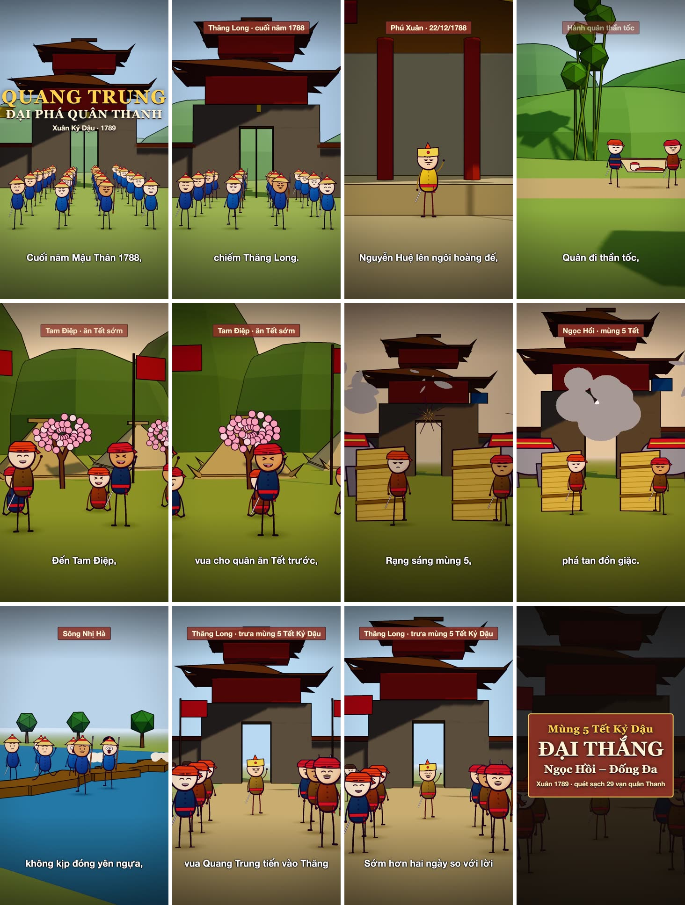
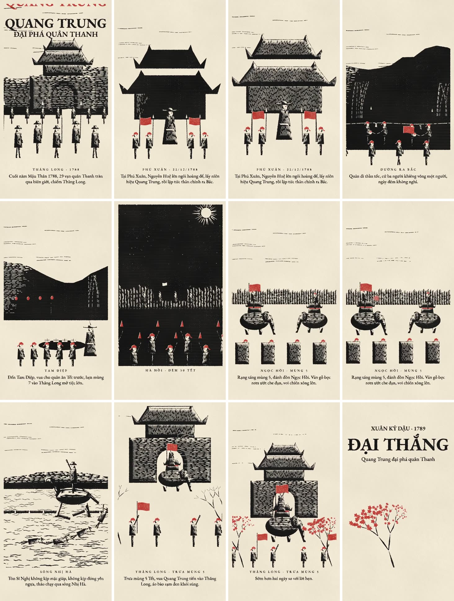

# RevidAPI · Phim ngắn lịch sử

**Xưởng phim 2D tự động:** mở `CHAY-XUONG-PHIM.cmd`, vào **http://localhost:3210** để dán truyện, chọn giọng, sửa nhân vật/cảnh trên web và xuất MP4. Xem [Hướng dẫn sử dụng](HUONG-DAN-SU-DUNG.md). Luồng này dùng Qwen và Piper cục bộ, không cần ChatGPT hay khóa API.

Dựng phim dọc 9:16 (1080×1920, ~60 giây) từ một file kịch bản. Có hai phong cách. Giọng đọc chạy qua **RevidAPI**, nhạc nền tự tổng hợp, phụ đề tự chia dòng.

| Phong cách | Demo | Công nghệ |
|---|---|---|
| **3D hoạt hình** low-poly, nét mực | [demo/quang-trung-3d.mp4](demo/quang-trung-3d.mp4) | Remotion + three.js |
| **Khắc gỗ** tranh in đen đỏ | [demo/quang-trung-khac-go.mp4](demo/quang-trung-khac-go.mp4) | three.js + trình duyệt không giao diện |

## Xem trước

**Phong cách 3D**



**Phong cách khắc gỗ**



## Yêu cầu

- Node.js ≥ 20, Python 3 + `numpy` (`python3 -m pip install numpy`), `ffmpeg` (macOS: `brew install ffmpeg`)
- Khoá API RevidAPI — đăng ký tại https://revidapi.com

## Dùng nhanh

```bash
git clone https://github.com/Revidapi-com/revidapi-phim-ngan.git
cd revidapi-phim-ngan
mkdir -p ~/.revidapi && printf '%s' 'KHOA_CUA_BAN' > ~/.revidapi/khoa && chmod 600 ~/.revidapi/khoa
./dung.sh 3d          # hoặc: ./dung.sh khac-go
```

Phim ra ở `ket-qua/`. Lần đầu lệnh tự cài thư viện (vài phút).

Thay vì lưu file khoá, có thể đặt biến môi trường cho một lần chạy: `REVIDAPI_KEY=... ./dung.sh 3d`.

## Lệnh làm gì

1. Kiểm tra khoá RevidAPI — thiếu khoá thì dừng.
2. Gửi kịch bản lên RevidAPI đọc thành giọng (`POST /v1/text-to-speech`). Kịch bản không đổi thì dùng lại giọng cũ, không trừ credit lần nữa.
3. Đo độ dài giọng; bản 3D tự co giãn các cảnh theo đó.
4. Tổng hợp nhạc nền (trống trận, sáo ngũ cung, cồng) và tự hạ nhạc khi có lời.
5. Dựng hình, ghép tiếng, xuất MP4.

## Tuỳ chỉnh

```bash
./dung.sh 3d kich-ban/cua-toi.txt 9019     # kịch bản khác, giọng khác
```

- **Giọng:** tham số thứ ba là `voice_id` (mặc định 9060 – Trung Kiên). Danh sách giọng xem trên dashboard RevidAPI.
- **Kịch bản:** file `.txt` tiếng Việt, đọc khoảng 45–50 giây là vừa khung 60 giây.
- **Phụ đề và cảnh:** 3D sửa trong `phong-cach-3d/src/phim/QuangTrung.tsx` (mảng `SUB`); khắc gỗ sửa trong `phong-cach-khac-go/phim/quang-trung/film.js`. Bản khắc gỗ dùng lịch cảnh cố định 60 giây.

## Chi phí

Chỉ bước giọng đọc tốn credit: **15 credit / 1.000 ký tự**. Kịch bản mẫu ~1.090 ký tự ≈ 16 credit. Dựng hình chạy trên máy bạn, không tốn credit.

## Cấu trúc

```
dung.sh                 lệnh duy nhất cần chạy
kich-ban/               kịch bản mẫu
revidapi/               gọi RevidAPI (giọng đọc)
chung/nhac.py           nhạc nền + trộn tiếng
phong-cach-3d/          dự án Remotion
phong-cach-khac-go/     bộ dựng khắc gỗ
demo/                   hai video mẫu
```

## Chạy trên VPS / tự động hoá

Mọi bước đều chạy không cần màn hình, nên dùng được trên VPS Linux (Ubuntu 22.04+), cron hay n8n. Giọng đọc luôn gọi API RevidAPI.

Cài một lần trên Ubuntu:

```bash
sudo apt update && sudo apt install -y ffmpeg python3-numpy git curl
curl -fsSL https://deb.nodesource.com/setup_20.x | sudo -E bash - && sudo apt install -y nodejs
git clone https://github.com/Revidapi-com/revidapi-phim-ngan.git && cd revidapi-phim-ngan
npx -y playwright-core install-deps chromium
```

Khoá đặt qua biến môi trường thay cho file (hợp với cron/n8n):

```bash
REVIDAPI_KEY=sk_... ./dung.sh 3d kich-ban-moi.txt
```

Ví dụ cron dựng mỗi sáng 6 giờ từ file kịch bản:

```cron
0 6 * * * cd ~/revidapi-phim-ngan && REVIDAPI_KEY=sk_... ./dung.sh khac-go hom-nay.txt >> dung.log 2>&1
```

Trong n8n: dùng node **Execute Command** chạy đúng lệnh trên, rồi lấy file ở `ket-qua/`.

Lưu ý: VPS nên có từ 4 GB RAM; phong cách 3D render bằng CPU sẽ chậm hơn máy có GPU (vài phút đến vài chục phút).

## Giấy phép

Xem [GIAY-PHEP.md](GIAY-PHEP.md).
